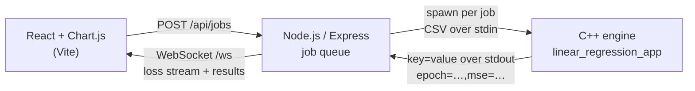
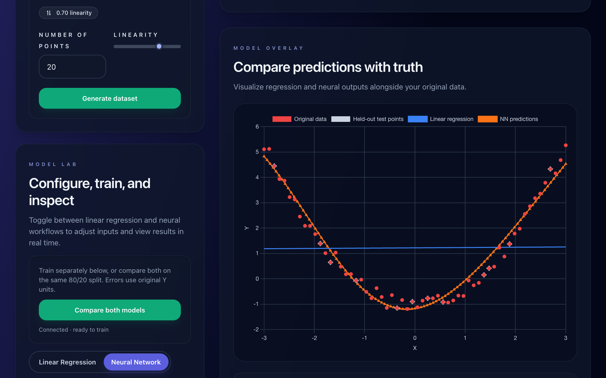

# C++ ML Playground

[](https://github.com/Nicolas2912/cpp-ml-react/actions/workflows/cpp.yml)
[](https://github.com/Nicolas2912/cpp-ml-react/actions/workflows/server.yml)
[](https://github.com/Nicolas2912/cpp-ml-react/actions/workflows/client.yml)

Train a linear regressor and a neural network, both written from scratch in C++, on the same data and compare them on a held-out test set. Training loss streams live to a React UI over WebSockets.


On the wave sample above, the network reaches a test MSE of 0.036 versus 0.69 for the straight-line fit, both measured on the same 12 held-out points.

**Highlights**

- **From-scratch C++ engine.** Backpropagation, sigmoid/tanh/ReLU activations with Xavier/He initialization, closed-form least squares, and full-precision model serialization. No ML libraries. The backprop gradient is checked against finite differences in the unit tests.
- **Honest evaluation.** Both models share a seeded 80/20 split; scaling uses training data only, and every MSE is reported in original Y units.
- **Live training.** Each run is an isolated job in its own C++ process, streaming loss over a WebSocket, with cancellation, timeouts, and per-session ownership.
- **Real inference.** New predictions reload the trained C++ weights rather than interpolating the plotted curve.
- **Tested end to end.** C++ unit tests, server integration tests that drive real engine processes, and UI tests all run in CI, along with the production build.

## Architecture



The server validates and scales the data, splits it, and runs each training job as a bounded C++ subprocess. It parses streamed progress lines and forwards them only to the WebSocket session that owns the job. Trained models are kept in memory as serialized weights, so later predictions run the real network.



## Current features

- Compose comma-separated X/Y data, load linear, curved, or wave samples, or generate randomized data with point-count and linearity controls.
- Train linear regression and the neural network independently from their original model tabs, or train both together on the same deterministic 80/20 split.
- Inspect the raw dataset and the combined model overlay, including training points, held-out points, fitted curves, and new predictions.
- Compare training MSE, held-out test MSE, test R², and compute time in one table. All displayed MSE values use the original Y scale.
- Stream neural-network loss during training and cancel an active run.
- Build a `1-N-…-1` neural architecture visually: add or remove hidden layers, choose 1–32 neurons per hidden layer, select nodes, and pan, zoom, or fit the graph.
- Choose the hidden-layer activation: sigmoid (default), tanh with Xavier initialization, or ReLU with He initialization.
- Predict from either original model panel or evaluate both trained models together. Neural predictions reload the trained C++ weights rather than interpolating displayed points.
- Switch between the original light and dark themes. The full workflow is responsive on narrow screens.

## Run with Docker

```sh
docker build -t cpp-ml-playground .
docker run --rm -p 8080:3001 cpp-ml-playground
```

Open http://localhost:8080. The image compiles and tests the C++ engine, builds the client, and runs the server as a non-root user. A single process serves the page, the API, and the WebSocket.

## Run locally

Requires Node.js 22.12+ (Node 24 LTS recommended), npm, make, and a C++11 compiler. GCC uses OpenMP; Clang can build sequentially when libomp is unavailable.

```sh
make -C cpp
npm --prefix server ci
npm --prefix client ci
```

Start these in separate terminals:

```sh
npm --prefix server start
npm --prefix client start
```

Open http://127.0.0.1:3000. Vite proxies `/api` and `/ws` to the API on port 3001. Both servers bind to loopback. Use the Vite origin for browser requests.

## What the comparison measures

- The server shuffles pairs with seed 42 and holds out 20% (rounded, at least one point) for datasets of 5 or more pairs. Both models use the same split, including when trained separately. Datasets of 2–4 pairs remain supported as training-only runs; test metrics are undefined.
- NN normalization uses **training values only**. Training loss, train MSE, and test MSE are all returned in original Y units squared.
- Lower test MSE means better predictions on this particular split. A low training error alone does not establish generalization. Repeated tuning against one test split can overfit that split.
- Test R² compares predictions with the test-set mean: 1 is perfect, 0 matches that baseline, and negative values are worse. It is undefined (`null`) for constant test targets or fewer than two test points.
- Compute time includes training and engine evaluation/output, excluding process startup and network latency. It is not a rigorous benchmark.
- NN hidden layers use the chosen activation (sigmoid by default, or tanh/ReLU); the output is linear. Training uses stochastic gradient descent with fixed initialization/shuffling seeds. Repeated runs with the same build and inputs are reproducible; timings and cross-platform floating-point results may vary.
- “Predict both” runs C++ inference using the actual trained parameters. NN weights round-trip at full double precision. New predictions are neither interpolation nor endpoint clamping.

## Structure

| Location                            | Purpose                                                                 |
| ----------------------------------- | ----------------------------------------------------------------------- |
| `client/src/App.jsx`                | Dataset, settings, and comparison workflow                              |
| `client/src/hooks/usePlayground.js` | Original frontend workflows, independent model state, and themed charts |
| `client/src/NNVisualizer.jsx`       | Editable network blueprint, node selection, zoom, and pan               |
| `client/src/hooks/useComparison.js` | Connection lifecycle and job updates                                    |
| `client/src/components/`            | Fit/loss charts, score table, prediction form                           |
| `server/server.js`                  | HTTP/WebSocket endpoints and session ownership                          |
| `server/jobs.js`                    | Training, evaluation, model retention, cancellation                     |
| `server/engine.js`                  | Bounded subprocess execution and streamed output parsing                |
| `server/data.js`                    | Validation, splitting, scaling, metrics                                 |
| `cpp/main_server.cpp`               | CLI protocol                                                            |
| `cpp/neural_network.*`              | Network training, inference, serialization                              |
| `cpp/linear_regression.*`           | Analytical regression and gradient-descent implementation               |

## Sessions and limits

A WebSocket connection receives an opaque session token. HTTP requests send it as `Authorization: Bearer <token>`. Jobs have unique IDs; only the owning session can read, cancel, or predict with them. Progress goes to that connection only.

Models live in server memory, with a 30-minute TTL and at most three retained runs per session. The retention logic keeps the latest independently trained LR and NN models available for comparison where possible. Disconnecting or restarting the server discards them; the UI reconnects and asks you to train again. This is a local playground, without accounts or disk model storage.

Limits: 2–1,000 input pairs; finite values within ±1,000,000; one input/output neuron; up to four hidden layers of 32 neurons; 1–10,000 epochs; learning rate in `(0, 1]`. A parameter × point × epoch budget rejects overly large runs. Each engine process has a 30-second timeout and a 2 MB output limit. The server allows four simultaneous compute operations, one training job per session, 32 connections, and 64 retained jobs globally. Disconnect and cancellation terminate associated subprocesses.

API:

| Method / path                | Purpose                                                                                                                                                                                                     |
| ---------------------------- | ----------------------------------------------------------------------------------------------------------------------------------------------------------------------------------------------------------- |
| `GET /api/health`            | API liveness                                                                                                                                                                                                |
| `POST /api/jobs`             | Train the selected model(s); body: `{x, y, layers, learningRate, epochs, activation, model}` (`activation`: `sigmoid` (default), `tanh`, or `relu`; `model`: `lr`, `nn`, or default `both`); returns `{id}` |
| `GET /api/jobs/:id`          | Recover the latest status, loss, and results                                                                                                                                                                |
| `POST /api/jobs/:id/cancel`  | Cancel an active run                                                                                                                                                                                        |
| `POST /api/jobs/:id/predict` | Evaluate both models; body: `{x, model}` (model optional)                                                                                                                                                   |

WebSocket `/ws` events: `session`, `progress`, `completed`, `failed`, `cancelled`. Job events include `id`. The former `/api/lr_*` and `/api/nn_train_predict` HTTP routes have been replaced by this unified job API.

## Verify

```sh
OMP_NUM_THREADS=1 make -C cpp test_all
npm --prefix server test
npm --prefix client test
npm --prefix client run build
```

Server integration tests launch real C++ processes and HTTP/WebSocket clients. They cover inference, metric scaling, repeatability, independent and paired training, small datasets, session isolation, model retention, validation, cancellation, expiry, capacity, malformed output, launch failure, and timeout. UI tests cover the restored composer and themes, separate model tabs, comparison training, prediction, architecture editing, node selection, cancellation, invalid data, stale updates, and disconnects. CI runs these checks and the production build.

Browser check: train LR and NN separately, then compare both; inspect held-out scores and predict through each original model input and the paired prediction form. In the Neural Network tab, show the blueprint, add/remove hidden layers, adjust neuron counts, select nodes, and use zoom/fit controls. Change the dataset, cancel a long run, and toggle the light/dark theme. Repeat at a narrow mobile width. Test loss of the API connection and recovery.

The production bundle is written to `client/build`. Set `STATIC_DIR=client/build` and `HOST=0.0.0.0` to have the Node server serve it on the same origin as `/api` and `/ws`; the Dockerfile does this.

## Network builder

Open the **Neural Network** tab to show the restored blueprint. The original layer-size input and the graph controls stay synchronized. Add up to four hidden layers, choose 1–32 neurons per hidden layer, remove layers, and select a node to inspect its layer. Input/output stay at one neuron for this X-to-Y regression app. Editing architecture invalidates the previous NN result while preserving a completed LR model for the same dataset. Model parameters are disabled during training.
